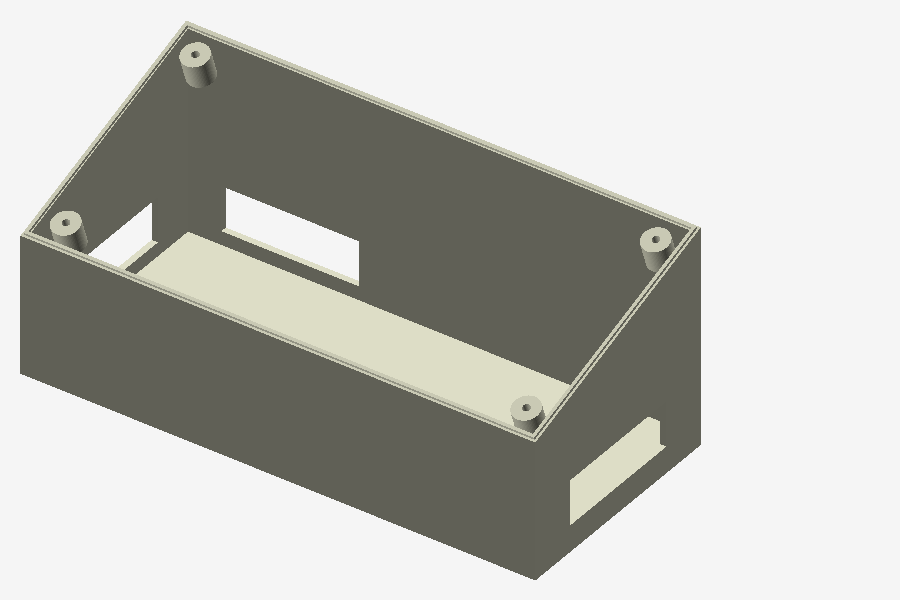
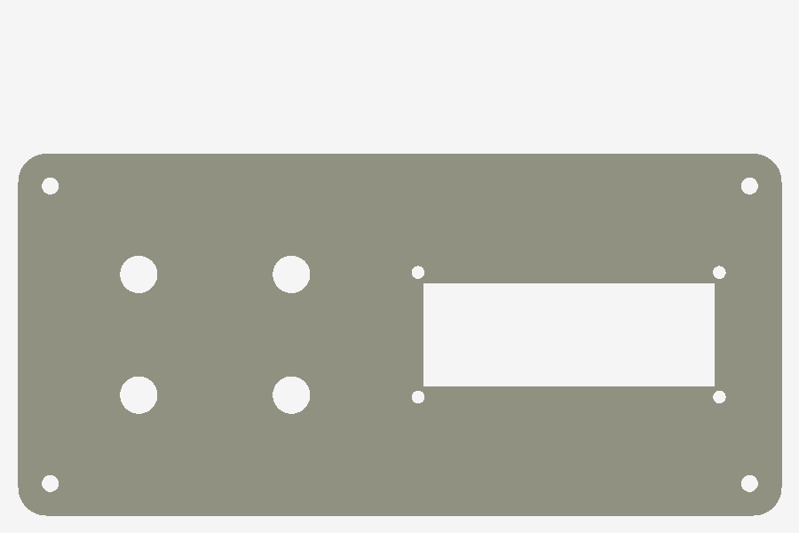

# Cutia de control (printare 3D)

Cutia cu cele 4 butoane și LCD-ul, ca în [poza montajului](../docs/img/setup-hardware.jpg). Are
două piese: o carcasă cu capacul înclinat spre elevi și un panou plat care se prinde deasupra.

| Fișier | Ce este | Dimensiuni |
|---|---|---|
| [`carcasa-consola.stl`](carcasa-consola.stl) | Carcasa: deschisă sus, cu marginea de sus înclinată (52 mm în față, 82 mm în spate), 4 stâlpișori pentru șuruburile panoului și decupaje în pereți pentru cablul-panglică | 194 × 89 × 82 mm |
| [`panou-butoane-lcd.stl`](panou-butoane-lcd.stl) | Panoul de sus: 4 găuri pentru butoane, fereastra pentru LCD și găurile de prindere | 190 × 90 × 3,2 mm |

| Carcasa | Panoul (văzut de sus) |
|---|---|
|  |  |

## Panoul

- **Butoanele:** 4 găuri de aprox. 9,4 mm, așezate 2×2: ABORT și STAGE sus, GO și LAUNCH jos.
  Așezarea e aceeași cu `button_layout` din `rocket_demo/config.py`, ca răspunsurile din quiz să
  apară pe ecran în colțul butonului lor. Verifică diametrul butoanelor tale înainte de printare.
- **LCD-ul:** fereastră pentru un modul LCD 1602, cu 4 găuri de prindere la 75 × 30 mm, distanța
  obișnuită la aceste module.
- **Prinderea:** 4 găuri în colțuri, în dreptul stâlpișorilor din carcasă.

## Printare

Setări orientative (PLA merge bine):

- strat de 0,2 mm, umplere 15–20 %;
- panoul se printează culcat;
- carcasa se printează cu fundul pe masă;
- culori: la noi, panoul e galben și carcasa neagră.

## Montaj

1. Prinde butoanele în panou și LCD-ul sub fereastră, cu 4 șuruburi mici.
2. Trece cablul-panglică de la Raspberry Pi prin decupajul din carcasă și leagă-l după
   tabelul de cablare din [README](../README.md#2-cablare).
3. Prinde panoul pe carcasă cu 4 șuruburi.
4. Lipește etichetele printate din [docs/etichete.html](../docs/etichete.html) lângă butoane și
   lângă LCD.

Modelele sunt făcute în OpenSCAD.
